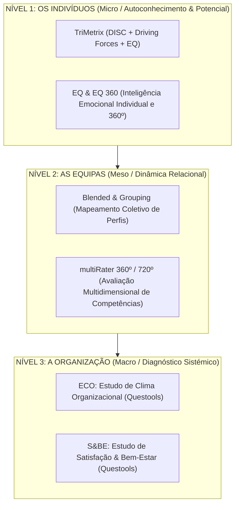

# Guia de Oferta e Integração de Assessments: TTI Success Insights & Questools

## 1. Visão Geral da Parceria
A **TTI Success Insights** (em aliança com as plataformas analíticas **Questools**) é parceira estratégica da **SKOLAE Formação** para diagnóstico psicométrico, avaliação comportamental e estudos organizacionais globais.

Esta oferta permite à SKOLAE posicionar-se não apenas como entidade de formação contínua, mas como **parceira estratégica de consultoria e desenvolvimento de talento**, ancorando a intervenção formativa em dados científicos de diagnóstico (Pre-work) e medição rigorosa de evolução (Pós-formação).

---

## 2. A Pirâmide de Soluções TTI Success Insights

A proposta de valor divide-se em **3 Patamares de Intervenção Integrada**:

---

## 3. Catálogo Detalhado de Ferramentas

### NÍVEL 1: O INDIVÍDUO — Identificar, Reter e Desenvolver Talento

#### A. TriMetrix® (A Ferramenta Rainha de Diagnóstico Individual)
* **O que mede:** Integra 3 camadas analíticas num único relatório executivo integrado:
  1. **Comportamentos (DISC):** *Como* a pessoa age e comunica no dia a dia (Dominância, Influência, Estabilidade, Conformidade), distinguindo o *Estilo Natural* (sob pressão) do *Estilo Adaptado* ao posto de trabalho.
  2. **Forças Impulsionadoras (Driving Forces / WPMOT):** *Por que* a pessoa age. Mapeia os 12 motivadores profundos agrupados em 6 áreas: Conhecimento, Utilidade, Enquadramento, Pessoas, Poder e Metodologias.
  3. **Inteligência Emocional (EQ):** *Com que maturidade relacional* a pessoa gere as suas emoções e as dos outros.
* **Formatos de Aplicação:** Questionário online assíncrono (25 a 35 minutos).
* **Entregáveis:** Relatório individual detalhado (Text & Graphs Consulting Expertise) + **Sessão Individual de Devolução / Debriefing** (60 minutos por participante com formador/coach certificado).
* **Público-alvo:** Diretores, Chefias Intermédias, Gestores Comerciais/KAMs, Colaboradores-Chave e High Potentials (HiPos).

#### B. EQ & EQ 360 (Emotional Quotient™)
* **O que mede:** A proficiência em Inteligência Emocional através de 5 dimensões nucleares:
  1. *Autoconsciência (Self-Awareness)*
  2. *Autorregulação (Self-Regulation)*
  3. *Motivação Interna (Motivation)*
  4. *Consciência Social / Empatia (Social Awareness)*
  5. *Regulação Social / Gestão de Relacionamentos (Social Regulation)*
* **Diferenciação EQ vs. EQ 360:**
  * **EQ Singular:** Autoavaliação com roda emocional gráfica (*Emotional Quotient Wheel*).
  * **EQ 360:** Combina a autoavaliação com a visão cruzada de superiores hierárquicos, pares e subordinados diretos.
* **Público-alvo:** Líderes em transição de carreira, gestores em ambientes de elevada pressão, profissionais em funções de atendimento crítico.

---

### NÍVEL 2: AS EQUIPAS — Liderança, Team Building e Performance

#### A. Blended & Grouping (Mapeamento Coletivo de Equipas)
* **O que é:** Agregação dos dados psicométricos individuais de uma equipa num único mapa visual coletivo.
* **Objetivo de Negócio:**
  * Revelar a cultura espontânea da equipa e a sua rotação de estilos;
  * Identificar zonas de complementaridade e ângulos mortos (ex.: excesso de foco em tarefas sem atenção às pessoas, ou excesso de consenso sem sentido de urgência);
  * Prevenir conflitos interpessoais entre perfis opostos.
* **Entregáveis:** Relatório de Dinâmica de Equipa + Workshop de Alinhamento e Teambuilding (1/2 dia a 1 dia).

#### B. multiRater 360º / 720º (Avaliação Multidimensional de Competências)
* **O que mede:** Avaliação de comportamentos críticos de gestão e liderança observados no terreno (Visão Estratégica, Resolução de Problemas, Liderança da Mudança, Orientação para Resultados, Gestão de Equipas, Comunicação Interpessoal).
* **Estrutura multiRater 360º:**
  * Autoavaliação vs. Avaliação da Chefia vs. Colaboradores Diretos vs. Colegas/Pares.
  * Matriz de Importância vs. Avaliação da Competência (GAPs e Prioridades de Desenvolvimento).
  * Matriz 9-Box com categorização visual de forças a alavancar e carências a acautelar.
* **Diferenciação multiRater 720º (Medição do Progresso):**
  * Aplicação do multiRater 360º no arranque (Baseline);
  * Intervenção formativa e planos de ação individuais;
  * **Reaplicação 6 a 9 meses depois (720º)** junto dos mesmos avaliadores para medir formalmente a evolução real de comportamentos (*Evidence of Transfer*).

---

### NÍVEL 3: A ORGANIZAÇÃO — Diagnóstico Sistémico, Clima e Cultura

#### A. ECO — Estudo de Clima Organizacional (Questools)
* **O que é:** Barómetro abrangente da perceção dos colaboradores sobre a organização, estruturado em **4 Eixos Fundamentais** (16 dimensões no total):
  1. **Empresa:** Sentido de pertença, lealdade, continuidade, salários e benefícios.
  2. **Liderança:** Visão e valores, gestão, motivação, desenvolvimento profissional.
  3. **Trabalho:** Satisfação e compromisso, meios e organização do trabalho, abertura à mudança, oportunidades de progresso.
  4. **Relação:** Espírito de equipa, comunicação, cooperação, relacionamento interpessoal.
* **Estrutura do Relatório Executivo:**
  * Indicadores globais e dados demográficos (idade, antiguidade, departamento);
  * Resultados globais e desagregados por polo/direção;
  * Análise semântica de comentários abertos recolhidos;
  * Conclusões e recomendações acionáveis para o Conselho de Administração / Direção de RH.
* **4 Pilares de Impacto:** Ferramenta de comunicação interna, cultura de feedback contínuo, base para ação estratégica e demonstração de compromisso autêntico da gestão.

#### B. S&BE — Estudo de Satisfação & Bem-Estar (Questools)
* **O que é:** Diagnóstico específico para avaliação de riscos psicossociais, satisfação diária e bem-estar corporativo, estruturado em **4 Grandes Famílias**:
  1. *Como me Sinto no meu Trabalho:* Ambiente, vivência diária e sentimentos associados à função.
  2. *A Liderança e a Gestão:* Desenho da função, clareza de expectativas, sistema de gestão e avaliação de desempenho.
  3. *Os meus Recursos Pessoais:* Resiliência individual, equilíbrio vida pessoal-profissional, energia e gestão do stress.
  4. *Como Executo o meu Trabalho:* Grau de controlo, autonomia, relações no posto e espaço de afirmação individual.
* **Público-alvo / Casos de Uso:** Organizações com elevados índices de turnover ou absentismo, processos de reestruturação/fusão, auditorias de sustentabilidade humana / ESG.

---

## 4. Matriz de Integração Pedagógica & Comercial na Oferta SKOLAE

A integração da oferta TTI / Questools nos percursos dedicados da SKOLAE deve seguir o princípio de **baixo atrito e aumento de valor agregado**, distribuindo-se pelas seguintes modalidades:

| Desafio / Pedido do Cliente | Ferramenta Recomendada | Solução de Formação SKOLAE Associada | Modelo de Entrega |
| :--- | :--- | :--- | :--- |
| **"Queremos desenvolver a comunicação e eficácia das equipas de vendas/negociação"** | **DISC / TriMetrix** | Vendas Consultivas, Negociação Estratégica, Comunicação 360º | Pre-work online + Devolução individual (60') + Formação intra 14h |
| **"Precisamos de trabalhar a inteligência emocional e a resiliência das chefias"** | **EQ ou EQ 360** | Liderança Empática, Gestão de Conflitos, Inteligência Emocional | Pre-work EQ + Workshop 14h + Plano de Ação Individual |
| **"As equipas operam em silos e há ruído entre departamentos"** | **Blended & Grouping (Equipas)** | Teambuilding Executivo, Dinâmicas de Cooperação e Confiança | Diagnóstico individual + Relatório de Equipa + Workshop Teambuilding (7h a 14h) |
| **"Temos um programa de desenvolvimento para novos diretores / Academia de Liderança"** | **multiRater 360º + multiRater 720º** | Academia de Líderes, Liderança de Equipas, Feedback e Coaching | 360º Inicial + Percurso de Formação + Mentoring + 720º aos 6 meses (Avaliação de Impacto) |
| **"Sentimos que o clima está degradado após a reestruturação e queremos saber por onde começar"** | **ECO (Estudo de Clima Organizacional)** | Gestão da Mudança, Cultura Organizacional, Comunicação Interna | Estudo ECO Questools + Apresentação à Administração + Ciclo de Formações Corretivas à Medida |
| **"Queremos reforçar o bem-estar e combater o burnout / cumprir metas ESG"** | **S&BE (Satisfação & Bem-Estar)** | Bem-Estar Corporativo, Liderança Humanizada, Gestão de Stress | Barómetro S&BE + Relatório Demográfico + Workshops de Resiliência e Liderança |

---

## 5. Guião de Prospeção e Qualificação Comercial (Business Developers)

### Como Apresentar ao Cliente (Speech Elevador)
> *"Na SKOLAE não desenhamos formações genéricas. Trabalhamos com uma metodologia sustentada em dados: antes de entrarmos em sala, aplicamos diagnósticos científicos e psicométricos (em parceria com a TTI Success Insights e Questools). Isto permite que cada participante tenha consciência clara do seu perfil e forças motrizes, e que a Direção de RH meça exatamente a evolução comportamental e o retorno do projeto."*

### Gatilhos Verbais do Cliente $\rightarrow$ Reação Comercial Imediata
* **Se o cliente diz:** *"Já fizemos muita formação de liderança mas depois tudo volta ao mesmo..."*  
  $\rightarrow$ **Reação:** Propor o **multiRater 360º + 720º**, demonstrando que a avaliação a 6 meses fecha o ciclo de responsabilidade e mede a transferência real no terreno.
* **Se o cliente diz:** *"Temos pessoas com perfis muito diferentes na equipa comercial e há fricção..."*  
  $\rightarrow$ **Reação:** Propor **TriMetrix com Blended & Grouping**, integrando uma sessão de devolução individual antes do workshop coletivo.
* **Se o cliente diz:** *"A administração quer um retrato sério da empresa antes de definir o plano anual..."*  
  $\rightarrow$ **Reação:** Apresentar o **ECO (Estudo de Clima Organizacional)** em 4 eixos como a porta de entrada diagnóstica perfeita para desenhar o plano de capacitação cirúrgico.
