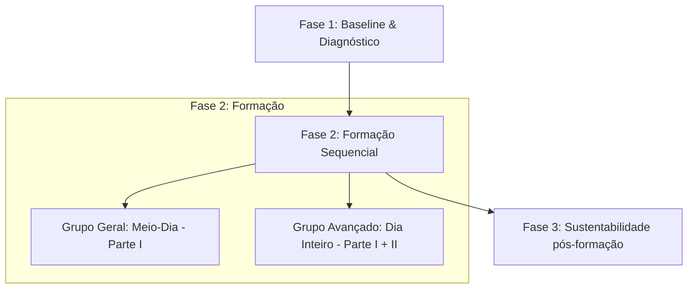

# Contexto do Cliente: Cegid

*Links:* [Progresso Comercial](./cegid_progress.md) | [Notas de Reunião](./cegid_meeting_notes.md)


## Perfil da Empresa
* **Nome:** Cegid (resultado da integração das marcas Primavera e PHC em Portugal).
* **Sector:** Software de Gestão / Tecnologias de Informação.
* **Presença:** Operação ibérica (Portugal e Espanha).
* **Desafio Atual:** Integração de culturas e processos pós-aquisição. Unificação da equipa de RH e managers com diferentes níveis de exigência e estilos de liderança.

## Stakeholders Identificados
* **Dalila Brito:** HRBP e Responsável pela Formação em Portugal (ex-Primavera). Ponto de contacto central para PT e articuladora com Espanha. Perfil pragmático, focado em resultados práticos.
* **Safa Masmoudi:** Destinatária principal (IT/IS) da proposta de Cibersegurança/GDPR. Participou ativamente no desenho do projeto.
* **Susana Abas Burgos:** Participante no diagnóstico técnico de IT IS.
* **Diana Sanchez:** Participante no diagnóstico técnico de IT IS.
* **Laura Bellido Banares:** Em CC na entrega final da proposta técnica/financeira.
* **Grecia Paola Franco Jimenez:** Em CC na entrega final da proposta técnica/financeira.

## Dores e Necessidades Centrais
1. **Inteligência Artificial (IA):**
   * **Gestão de Projetos:** Otimizar planeamento, tomada de decisão e eficiência na execução. Público-alvo com agilidade tecnológica (ex-programadores). Utilizam plataforma interna "Missy" e ferramentas externas (ChatGPT, Claude).
   * **Marketing:** Produção de conteúdos e automação criativa. Tópicos de referência (Ibérico):
     1. Pesquisa, jornadas e audiências com IA.
     2. Ideação e copywriting com IA.
     3. Inteligência de negócio e insights com IA.
     4. Copilot 365 e criatividade com IA.
     5. Automatização e criação de agentes.
3. **Cibersegurança e Proteção de Dados (Internacional):**
   * **Âmbito:** Portugal, Espanha e França (Grupo Cegid).
   * **Público:** Equipas de desenvolvimento interno (IT/IS) que lidam com dados sensíveis.
   * **Foco:** Security & Risk Management e GDPR aplicado ao desenvolvimento.
2. **Liderança e Feedback:**
   * **Dor Crítica:** Dificuldade dos managers (especialmente ex-PHC) em dar feedback assertivo e concreto. Isto gera desalinhamento em avaliações de desempenho e revisões salariais ("feedback soft" que resulta em surpresas negativas no bónus).
   * **Necessidade:** Desenvolver assertividade mantendo a motivação.

## Histórico Comercial
* **2026-06-24:** Reunião técnica de alinhamento com equipa IT IS da Cegid (Susana, Safa, Diana). Pedro Gonçalves (formador) esteve presente e ficou de desenhar os programas das ações. Identificou-se a necessidade de um teste de maturidade inicial (*baseline*), foco em fluxos B2B e acompanhamento contínuo pós-formação (microlearning, videocast, newsletter, training lab).
* **2026-06-05:** Receção de email de Dalila Brito a propor reunião para dia **24 de junho às 15:00 CET** (14:00 PT) com os *managers* das áreas de IT/IS para levantar necessidades de GDPR e Security & Risk Management para Portugal, Espanha e França.
* **2026-05-05:** Envio da proposta pedagógica e financeira para "IA Aplicada ao Marketing" (Ref: 20139) — duas turmas de 7h, com o valor de 4.140,00 € + IVA (desconto de 10% aplicado para adjudicação conjunta).
* **2026-04-28:** Reunião de diagnóstico inicial com Bruno. Identificação de oportunidades em IA (PT/ES), Liderança e posterior receção de pedido para cibersegurança/GDPR ibérico.


---
## Detalhes da Proposta Fechada - Security & GDPR (Julho 2026)
*A proposta em PDF foi submetida a 08-07-2026. Os detalhes estruturais e de preços encontram-se abaixo guardados para registo histórico:*

# Proposta de Formação: Security & Risk Management e GDPR

**Cliente:** Cegid  
**Destinatários:** Equipa de IT IS (Sistemas de Informação) — ~80 colaboradores (Portugal, Espanha e França)  
**Entidade Formadora:** Skolae  
**Data:** Julho de 2026  

---

## 1. Enquadramento e Objetivos do Projeto

A equipa de IT IS da Cegid desempenha um papel crítico no suporte aos processos de negócio B2B (tais como *lead to order*, *order to cash*, *record to report* e *hire to retire*). Com o aumento da complexidade operacional e o processamento de dados confidenciais à escala do Grupo, surge a necessidade urgente de nivelar e elevar a maturidade da equipa em termos de cibersegurança e proteção de dados (RGPD).

Este programa foi desenhado especificamente para responder a este desafio, garantindo uma abordagem prática e operacional que ajude a equipa a:
*   **Identificar e Mitigar Riscos:** Adotar o risco de segurança como linguagem comum em alinhamento com os referenciais ISO 27001, SOC 2 e as diretivas NIS2 / DORA.
*   **Combater o Shadow IT:** Agir proativamente perante a contratação não homologada de ferramentas SaaS e integrá-las de forma segura no ecossistema da Cegid.
*   **Garantir a Conformidade (GDPR):** Operar com sensibilidade sobre direitos de acesso temporários, bases de dados de RH/salários e tratamento de dados de terceiros.
*   **Responder a Incidentes:** Detetar, analisar e reportar falhas de segurança e violações de dados pessoais dentro das 72 horas exigidas.

---

## 2. Metodologia de Implementação (3 Fases)

Para responder à heterogeneidade de competências da equipa de IT IS, propomos uma metodologia em três fases consecutivas:



### Estrutura do Slide: Roteiro de Aprendizagem & Segmentação (Roadmap)

```
                       [ 80 Colaboradores de IT IS ]
                                     |
                       [ FASE 1: QUESTIONÁRIO BASELINE ]
                    (Diagnóstico de Maturidade Técnico/RGPD)
                                     |
                  +------------------+------------------+
                  |                                     |
         [ Pontuação Geral ]                  [ Pontuação Avançada ]
         (ou perfis de suporte)               (ou perfis de sistemas críticos)
                  |                                     |
        [ CAMINHO A: GERAL ]                 [ CAMINHO B: AVANÇADO ]
        Meio-Dia de Formação (~3.5h)         Dia Completo de Formação (~7h)
                  |                                     |
       * Apenas a Parte I do programa       * Parte I (Manhã) + Parte II (Tarde)
       * Foco: Higiene digital, Shadow      * Foco: Mapeamento ISO 27001/SOC 2,
         IT e boas práticas B2B               DPIAs, Tabletop de incidentes e NIS2
```

#### Detalhe do Roteiro:

*   **Fase 1: Questionário Baseline (Diagnóstico Prévio)**
    *   *O que é:* Um questionário de diagnóstico técnico e situacional online (~15 minutos) respondido por todos os formandos antes do curso.
    *   *Objetivo:* Medir a maturidade inicial e detetar lacunas de conhecimento no departamento.
    *   *Impacto:* Garante que os formandos são agrupados de forma homogénea e lógica.

*   **Caminho A: Grupo Geral (Curso de Meio-Dia / ~3.5h)**
    *   *Destinatários:* Colaboradores com pontuação inicial de partida básica ou que necessitam de consolidação de higiene digital nas tarefas diárias.
    *   *Programa:* Foco exclusivo na **Parte I (Security & Risk Management)**.
    *   *Objetivo:* Criar hábitos de segurança, identificar Shadow IT e responsabilizar individualmente para evitar fugas de informação em operações B2B.

*   **Caminho B: Grupo Avançado (Curso de Dia Inteiro / ~7h)**
    *   *Destinatários:* Engenheiros, arquitetos, analistas de SOC ou perfis com privilégios de acesso a sistemas críticos e bases de dados sensíveis (ex: payroll/RH).
    *   *Programa:* Execução completa da **Parte I (Manhã)** e **Parte II (Tarde - GDPR & Incident Response)**.
    *   *Objetivo:* Habilitar a equipa a desenhar controlos de segurança complexos, mapear normas (ISO 27001 / SOC 2), realizar avaliações de impacto (DPIA), conduzir a triagem de violações de dados nas 72h legais e antecipar diretivas (NIS2/DORA).

### Fase 3: Acompanhamento Pós-Formação (Sustentabilidade)
Para garantir que o conhecimento se transforma em hábitos diários, propomos uma cadência contínua após as sessões:
*   **Microlearning:** Pílulas de e-learning rápidas com cenários práticos pós-formação.
*   **Videocast / Webinar Gravado:** Sessão gravada de revisão de conceitos com base nas dúvidas mais frequentes.
*   **Newsletters Mensais:** Partilha de boas práticas, alertas de segurança e novos cenários de Shadow IT.
*   **Training Labs:** Sessões práticas opcionais em formato de laboratório para testar vulnerabilidades em ambientes controlados.

---

## 3. Programa Pedagógico Detalhado

A formação será entregue nos idiomas de preferência das equipas (**Inglês, Espanhol e Francês**) com formadores nativos. O conteúdo técnico do programa detalhado está estruturado como se segue:

### Módulo I — Security & Risk Management (Comum a Todos os Formandos)

#### 1. Risk Management Fundamentals
*   Security risk in a SaaS and multi-tenant context: threats, vulnerabilities, impact.
*   Risk assessment and treatment: identifying, evaluating and prioritising risks to personal data.
*   The risk-based approach as the common language of GDPR, ISO 27001 and NIS2.
*   Roles and accountability: security, DPO, legal and management.

#### 2. Security Controls and Frameworks
*   Technical and organisational measures: access control, encryption, pseudonymisation, segregation, backup and resilience.
*   Security by design in the software development lifecycle (SDLC).
*   Mapping controls across frameworks: GDPR Article 32 ↔ ISO 27001 ↔ SOC 2.
*   Customer assurance: audits, certifications and evidence.

---

### Módulo II — GDPR / Data Protection & Breach Management (Apenas Grupo Avançado)

#### 3. GDPR Essentials for Security Professionals
*   Scope and key concepts: personal data, special categories, processing.
*   Personal data in technical environments: IPs, identifiers, logs, telemetry.
*   The data protection principles and lawful bases — legitimate interests as the basis for security operations.
*   Controller, processor and sub-processor: where Cegid stands in each product line.

#### 4. Security of Processing and Data Protection by Design
*   Article 32: what “appropriate measures” means in practice.
*   Data protection by design and by default (Article 25).
*   Data Protection Impact Assessments (DPIAs): triggers and the security team's input.
*   *Practical Workshop:* Defining the minimum control set for a new cloud payroll module.

#### 5. Personal Data Breach Management
*   Security incident vs. personal data breach: definitions and triage.
*   The 72-hour rule and Cegid's duty as processor to notify customers without undue delay.
*   Notification to authorities and communication to data subjects.
*   Documentation, evidence and the internal breach register.
*   *Tabletop Exercise:* Compromised credentials in a multi-tenant environment.

#### 6. Data Protection in Daily Security Operations
*   Logging, monitoring and retention.
*   Production data in test and development environments.
*   International transfers and vetting new tools and vendors (Shadow IT).
*   Data subject rights meeting infrastructure: what deletion really means.
*   The regulatory landscape ahead: NIS2, DORA and the EU AI Act (including AI embedded in Cegid products).

---

## 4. Proposta Comercial e Faturação

Para facilitar o processo logístico e administrativo de cada subsidiária da Cegid, a faturação poderá ser dividida e emitida localmente pela Skolae nos respetivos países:
*   **Faturação em Portugal:** Emitida pela Skolae Portugal.
*   **Faturação em Espanha:** Emitida pela Skolae Espanha (facilitando a bonificação através do sistema **FUNDAE**).
*   **Faturação em França:** Emitida pela Skolae França.

### Valores de Investimento por Turma (Rascunho a rever)

| Serviço Pedagógico | Duração | Preço por Turma | Notas / Condições |
| :--- | :--- | :--- | :--- |
| **Questionário Baseline (Fase 1)** | — | **Incluído** | Oferta comercial mediante adjudicação das turmas. |
| **Parte I (Grupo Geral)** | Meio-Dia (3.5h) | **1.300,00 €** | Foco em Segurança e Gestão de Riscos. |
| **Parte II (Grupo Avançado — Add-on)** | Meio-Dia (3.5h) | **1.000,00 €** | Foco em GDPR, DPIAs e Simulações. |
| **Dia Completo (Grupo Avançado)** | Dia Inteiro (7h) | **2.300,00 €** | Integração total das Partes I e II. |
| **Acompanhamento (Fase 3)** | — | *Sob Consulta* | Definição de cadência de microlearning/videocasts. |

*Nota: Os valores apresentados não incluem IVA à taxa legal em vigor.*

### Termos e Condições Comerciais

*   **Faturação:** 50% na adjudicação do projeto (início do diagnóstico / Baseline) e 50% na conclusão das respetivas turmas.
*   **Condições de Pagamento:** 30 dias a contar da data de emissão da fatura.
*   **Validade da Proposta:** 60 dias.
*   **Faturação Localizada:** Conforme as necessidades da Cegid, as faturas serão emitidas localmente pelas subsidiárias correspondentes da Skolae em Portugal, Espanha (permitindo o registo na FUNDAE) e França.
*   **Dados de Faturação da Entidade (Portugal):**
    *   **Entidade:** IF EXECUTIVES - EDIÇÕES E FORMAÇÃO, S.A. (Skolae Portugal)
    *   **Morada:** Avenida da Liberdade, 144 3º Dto, 1250-146 Lisboa, Portugal
    *   **NIF / TIN:** PT504700669
    *   **IBAN:** PT50 0033 0000 0019 9867 5310 5


### Ligações para os Programas Base de Conhecimento
* [Programa Detalhado (PT)](../../../01_Conhecimento_Base/011_Biblioteca_Programas/03_Tecnologias_Informacao/programa_ciberseguranca_gdpr_cegid.md)
* [Programa Detalhado (EN)](../../../01_Conhecimento_Base/011_Biblioteca_Programas/16_Oferta_em_Ingles/programa_ciberseguranca_gdpr_cegid_en.md)
* [Relatório de Reunião de Diagnóstico](../../034_Reunioes_Clientes/2026-06/meeting-report-cegid-2026-06-24.md)
