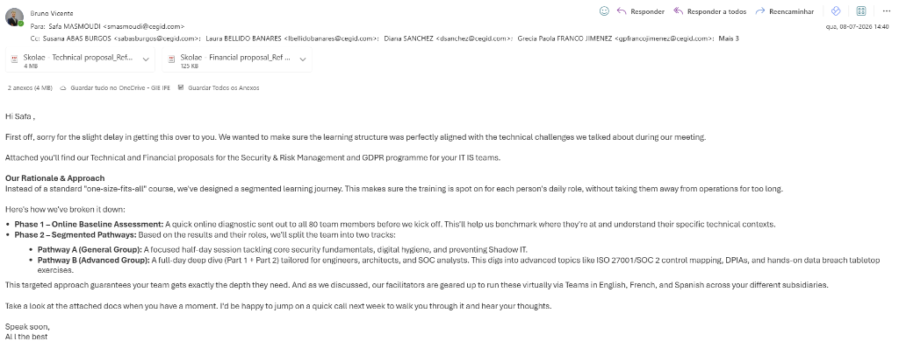
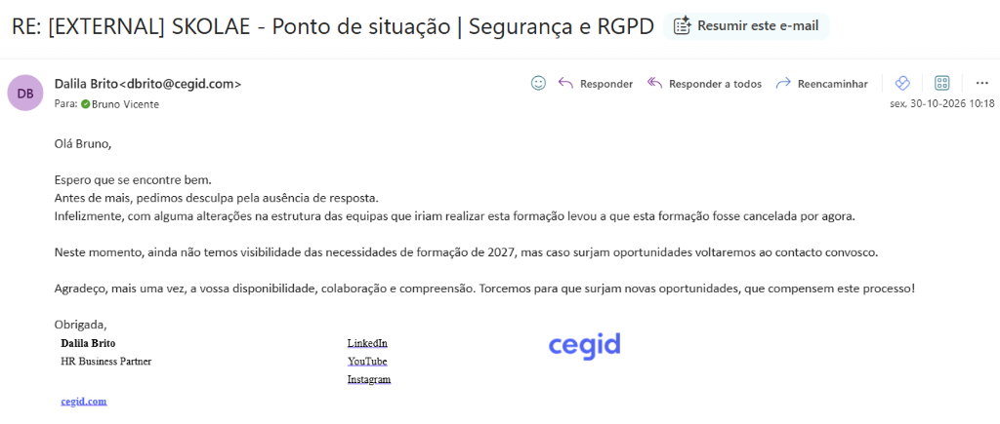

# Progresso de Vendas: Cegid

*Links:* [Contexto](./cegid_context.md) | [Notas de Reunião](./cegid_meeting_notes.md)

## Status do Funil
* **Fase Atual:** Cancelada por Reestruturação Interna / Em Pausa (Radar 2027)
* **Temperatura:** Fria (Processo formalmente encerrado para 2026)

## Histórico de Interações
* **2026-10-30:** Dalila Brito respondeu ao ponto de situação de Segurança e RGPD a comunicar o cancelamento formal da formação: alterações na estrutura interna das equipas de IT/IS ditaram a anulação do projeto por agora. A Cegid não tem ainda visibilidade das necessidades de 2027, mantendo abertura para futuras oportunidades.
* **2026-09-10:** Envio de e-mail de follow-up para aferir o estado de análise das propostas de Cibersegurança e GDPR.
* **2026-07-08:** Envio das propostas Pedagógica e Financeira (Security & Risk Management and GDPR) a Safa Masmoudi e Diana Sanchez, propondo segmentação em duas *pathways* formativas.
* **2026-07-08:** Validação da estrutura com o formador Pedro Gonçalves e criação do programa de formação final em Português e Inglês (UK) de acordo com a Skill SKOLAE.
* **2026-07-02:** Receção de e-mail de Safa Masmoudi a solicitar ponto de situação da proposta. Resposta enviada a confirmar o envio até amanhã (03/07) e a pedir desculpa pelo ligeiro atraso.
* **2026-06-24:** Reunião técnica de diagnóstico com a equipa de IT IS da Cegid (Susana Vas, Safa Masmoudi, Diana Sanchez). Pedro Gonçalves (formador) esteve presente e ficou de preparar os programas detalhados das ações de GDPR e Segurança.
* **2026-06-05:** Email de Dalila Brito a propor reunião de alinhamento com managers de IT/IS para dia 24/06 às 15:00 CET.
* **2026-05-05:** Envio das propostas pedagógica e financeira para IA Marketing (Ref: 20139) no valor de 4.140,00 € + IVA (2 turmas).
* **2026-04-29:** Confirmação por e-mail das nossas capacidades técnicas (GDPR e Segurança) e linguísticas (PT/ES/FR) para o projeto de IT/IS.
* **2026-04-28:** Reunião de diagnóstico. Identificação de 3 eixos: IA PM (Ibérico), IA Marketing (PT) e Liderança (PT).

## Próximos Passos (Next Actions)
1. **[BRUNO]** Enviar breve e-mail de resposta à Dalila Brito em tom descontraído e desdramatizado ("sem qualquer problema, mantemos a porta aberta para 2027").
2. **[CADÊNCIA COMERCIAL]** Reativar contacto com Dalila Brito em Q1 2027 para levantamento de prioridades do novo plano anual.
3. **[ARQUIVO]** Dossier colocado em estado Adormecido.

## Notas Estratégicas
* **Argumento Vencedor:** Faturação via Espanha (Skolae ES) e experiência com perfis tecnológicos (Natixis/Axians).
* **Risco:** Fragmentação dos pedidos entre várias áreas. Manter Dalila como pivô central.
* **Acompanhamento Pós-Formação (Ideias com Nuno):** Sugerir uma cadência de atividades contínuas de sustentabilidade a longo prazo:
    *   Microlearning
    *   Webinar gravado / videocast
    *   Newsletter (uma ou mais)
    *   Training Lab

### Comprovativo de Envio da Proposta

### Comprovativo de Cancelamento (30/10/2026)

